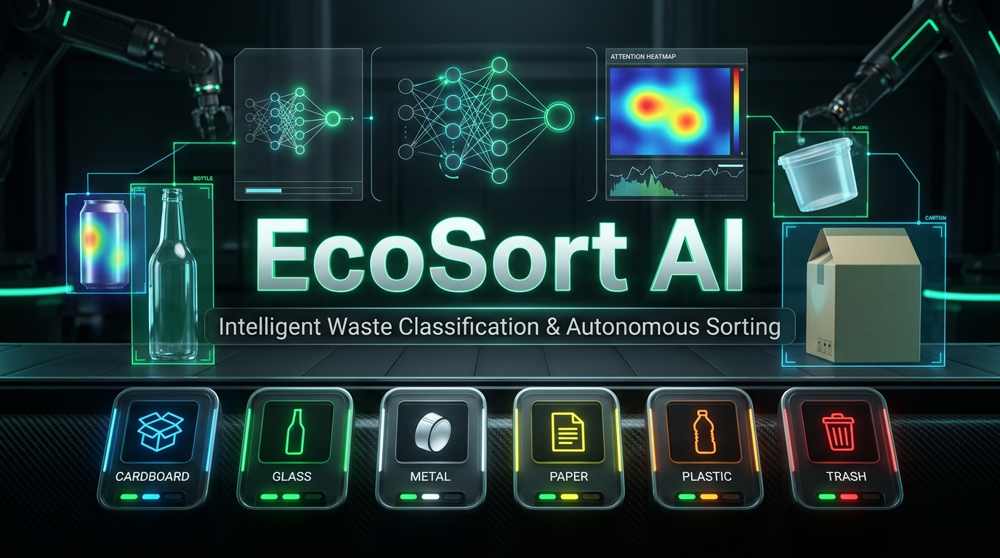
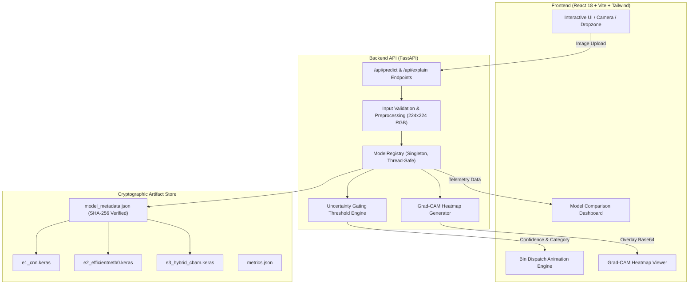

<div align="center">



# 🌿 EcoSort AI
### *Intelligent Waste Classification & Autonomous Sorting System Using Hybrid Deep Learning*

[](https://www.python.org/)
[](https://www.tensorflow.org/)
[](https://keras.io/)
[](https://fastapi.tiangolo.com/)
[](https://reactjs.org/)
[](https://www.typescriptlang.org/)
[](https://tailwindcss.com/)
[](https://opensource.org/licenses/MIT)

<p align="center">
  <b>Bridging Computer Vision, Explainable AI, and Environmental Sustainability</b>
  <br />
  Automated multi-class waste sorting • Dual-attention CBAM network • Real-time Grad-CAM heatmaps • Confidence uncertainty gating • Physics-inspired interactive web app
</p>

[Explore Highlights](#-key-features) •
[Architecture](#-system-architecture) •
[Benchmark Results](#-model-benchmarks--performance) •
[Quickstart](#-quickstart-guide) •
[API Reference](#-api-documentation) •
[Citation](#-dataset--references)

---

</div>

## 📌 Overview

Contamination in municipal recycling streams represents one of the largest economic and operational bottlenecks in global waste management. **EcoSort AI** is a full-stack, research-grade computer vision application engineered to solve this challenge at the source.

By pairing modern **hybrid deep learning architectures** with **explainable AI (XAI)** and a **human-centric interactive interface**, EcoSort AI classifies waste into 6 standardized recycling streams:

1. 📦 **Cardboard**
2. 🍶 **Glass**
3. 🥫 **Metal**
4. 📄 **Paper**
5. 🧴 **Plastic**
6. 🗑️ **General Trash**

### The Core Problem Solved
Traditional recycling sorting fails because of visual ambiguity (e.g. crushed plastic vs. glass bottles) and the "black-box" nature of neural networks. EcoSort AI addresses both:
- **Attention-Guided Feature Localization**: Integrates a **Convolutional Block Attention Module (CBAM)** combining Channel Attention (inter-channel feature weighting) and Spatial Attention (salient structural localization).
- **Grad-CAM Transparency**: Provides visual verification of why the model reached its decision.
- **Uncertainty-Aware Gating**: Explicitly rejects borderline or out-of-distribution items using validation-tuned confidence thresholds to avoid contaminating clean recycling batches.

---

## ✨ Key Features

| Capability | Technical Realization | Impact |
|---|---|---|
| **Hybrid Deep Learning** | EfficientNetB0 + CBAM (Channel & Spatial Attention) | High discriminatory power for fine-grained material recognition |
| **Explainable AI (XAI)** | Class Activation Mapping via Layer-wise Grad-CAM | Visual accountability and transparency for every inference |
| **Uncertainty Gating** | Validation-calibrated confidence rejection thresholds | Prevents costly contamination from ambiguous inputs |
| **Robust API Backend** | Asynchronous FastAPI with SHA-256 artifact verification | Sub-second inference, cryptographic model integrity checks |
| **Interactive UI** | React 18, TypeScript, Vite, Tailwind CSS & Framer Motion | Drag-and-drop file scanner, animated bin dispatching, model comparison |
| **Model Comparison** | Side-by-side inference engine with multi-model telemetry | Instant verification across E1 (Custom CNN), E2 (Baseline), and E3 (Proposed) |

---

## 🔬 Deep Learning Architectures

EcoSort AI evaluates and implements **three distinct model paradigms** trained on the benchmark TrashNet dataset:

```
┌────────────────────────────────────────────────────────────────────────┐
│                        E1: Custom CNN (Baseline)                       │
│  Input (224x224x3) ──► 4x [Conv2D + BatchNorm + ReLU + MaxPool] ──► FC │
└────────────────────────────────────────────────────────────────────────┘

┌────────────────────────────────────────────────────────────────────────┐
│                     E2: EfficientNetB0 (TL Baseline)                   │
│  Input (224x224x3) ──► Pretrained Backbone ──► GlobalAvgPool ──► Dense │
└────────────────────────────────────────────────────────────────────────┘

┌────────────────────────────────────────────────────────────────────────┐
│                 E3: EfficientNetB0 + CBAM (Proposed Model)             │
│  Input (224x224x3) ──► Backbone ──► [Channel Attn] ──► [Spatial Attn]  │
│                                              │                │        │
│                                     (AvgPool + MaxPool)  (Conv 7x7)    │
│                                              │                │        │
│                                  GlobalAvgPool ──► Dense (Softmax)     │
└────────────────────────────────────────────────────────────────────────┘
```

### 1. Model E1 — Custom 4-Stage CNN (Scratch Baseline)
- Designed to establish a ground-level convolutional baseline without transfer learning weights.
- 4 stacked feature extraction blocks: Conv2D (filters: 32 → 64 → 128 → 256), Batch Normalization, ReLU activation, and MaxPooling2D.
- Dense classification head with 30% dropout for regularization.

### 2. Model E2 — EfficientNetB0 (Transfer Learning Baseline)
- Utilizes ImageNet-pretrained compound-scaled MBConv feature extractors.
- Frozen backbone with fine-tuning on custom dense top layers.

### 3. Model E3 — EfficientNetB0 + CBAM (Proposed Architecture)
- Augments the EfficientNetB0 feature maps with a **Convolutional Block Attention Module**:
  - **Channel Attention Module (CAM)**: Captures inter-channel cross-talk by aggregating spatial context via parallel Average Pooling and Max Pooling branches, routed through a shared bottleneck Multi-Layer Perceptron (`mlp_reduce` & `mlp_expand`).
  - **Spatial Attention Module (SAM)**: Computes inter-spatial relationships by performing channel-wise pooling followed by a 7×7 convolutional receptive field with Sigmoid gating.
- Single-source-of-truth implementation guaranteed between offline training and production runtime.

---

## 📊 Model Benchmarks & Performance

All models were evaluated under strict experimental protocols using a **stratified 70% / 15% / 15% train/val/test split** on held-out test data (TrashNet, 2,521 total images across 6 balanced classes).

### Comprehensive Benchmark Table

| Metric | E1: Custom CNN *(Baseline)* | E2: EfficientNetB0 *(Baseline)* | E3: EfficientNetB0 + CBAM *(Proposed)* |
|---|:---:|:---:|:---:|
| **Role** | Scratch Baseline | Transfer Learning | Proposed Hybrid Attention |
| **Attention Mechanism** | None | None | **CBAM (Channel + Spatial)** |
| **Total Parameters** | 422,086 | 4,379,049 | 4,585,308 |
| **Trainable Parameters** | 422,086 | 1,672,246 | 1,878,505 |
| **Model Size (.keras)** | 5.13 MB | 31.76 MB | 34.25 MB |
| **Train Accuracy** | 61.05% | 99.38% | 98.70% |
| **Validation Accuracy** | 61.64% | 89.95% | 87.83% |
| **Test Accuracy** | **60.16%** | **90.24%** | **89.45%** |
| **Macro Precision** | 53.14% | 89.03% | 88.44% |
| **Macro Recall** | 52.79% | 88.26% | 87.52% |
| **Macro F1-Score** | 0.518 | 0.885 | 0.875 |
| **CPU Latency (Median)** | ~38.1 ms | ~376.8 ms | ~386.5 ms |
| **Uncertainty Threshold** | 0.30 | 0.44 | 0.30 |
| **Selective Accuracy** | 63.72% *(at 89.5% cov)* | 91.67% *(at 98.2% cov)* | **89.45% *(at 100% cov)*** |

### Per-Class Performance (Proposed Model E3)

| Class | Precision | Recall | F1-Score | Support |
|---|:---:|:---:|:---:|:---:|
| 📦 **Cardboard** | **96.6%** | 93.4% | 0.950 | 61 |
| 🍶 **Glass** | 89.6% | **92.0%** | 0.908 | 75 |
| 🥫 **Metal** | 89.8% | 85.5% | 0.876 | 62 |
| 📄 **Paper** | 85.9% | 91.0% | 0.884 | 89 |
| 🧴 **Plastic** | **95.4%** | 86.1% | 0.905 | 72 |
| 🗑️ **Trash** | 78.9% | 75.0% | 0.769 | 20 |

> [!NOTE]
> **Statistical Evaluation**: A McNemar test comparing E2 vs E3 yielded $p = 0.607$, demonstrating comparable statistical classification power while E3 provides sharpened attention contours in Grad-CAM visualizations.

---

## 🏗️ System Architecture



---

## 📁 Repository Structure

```
EcosortAI/
├── .gitignore                   # Ignores .venv, node_modules, .keras binaries
├── README.md                    # Project documentation
├── run_backend.sh               # Quickstart script for FastAPI backend
├── run_frontend.sh              # Quickstart script for Vite frontend
│
├── backend/                     # FastAPI Production Service
│   ├── app/
│   │   ├── api/routes.py        # /predict, /explain, /compare, /models, /health
│   │   ├── core/artifacts.py    # Contract verification & SHA-256 hash checks
│   │   ├── core/config.py       # Pydantic environment configuration
│   │   ├── services/model_registry.py  # Model loader, predictor, Grad-CAM runner
│   │   ├── categories.py        # Waste taxonomy, bin schemes, and disposal tips
│   │   └── main.py              # Application lifecycle & CORS setup
│   ├── check_artifacts.py       # Standalone integrity validation script
│   └── requirements.txt         # Pinned TensorFlow 2.21.0 & Keras 3.15.1
│
├── frontend/                    # Modern React Single Page Application
│   ├── src/
│   │   ├── components/          # BinStation, IsoBin, Dropzone, Header, Footer
│   │   ├── pages/               # Scanner, Models, Explain, Methodology, Results
│   │   ├── api/client.ts        # Type-safe API client
│   │   └── state/ScanContext.tsx # Global scan state and telemetry
│   ├── tailwind.config.js       # Modern design tokens and custom palette
│   └── package.json             # React 18, Vite, Framer Motion, Recharts
│
├── ml/                          # Machine Learning & Research
│   ├── notebooks/               # EcoSort_AI_Simple_Training.ipynb (Colab-ready)
│   ├── src/ecosort_ml/          # Single-source-of-truth CBAM layers & Grad-CAM
│   │   ├── layers.py            # ChannelAttention, SpatialAttention, ResizeTo
│   │   └── gradcam.py           # Layer activation calculation
│   ├── artifacts/               # Model weights, SHA-256 hashes, test metrics
│   │   ├── models/              # e1_cnn, e2_efficientnetb0, e3_hybrid_cbam
│   │   ├── metrics/metrics.json # Full benchmark logs
│   │   └── model_metadata.json  # Cryptographic signatures and layer pointers
│   └── tests/                   # Notebook sync & export logic test suite
│
└── docs/                        # Specifications & Verification
    ├── assets/hero_banner.jpg   # High-resolution project banner
    ├── API.md                   # Detailed HTTP route specifications
    ├── ARTIFACT_CONTRACT.md     # Invariant rules for notebook-backend handoff
    ├── ENVIRONMENT.md           # Pinning & compatibility specifications
    └── TESTING_REPORT.md        # Comprehensive verification audit
```

---

## 🚀 Quickstart Guide

### Prerequisites
- **Python**: Version `3.10`, `3.11`, or `3.12`
- **Node.js**: Version `18.x` or higher
- **Git**

---

### Step 1: Clone the Repository
```bash
git clone https://github.com/<YOUR_USERNAME>/EcosortAI.git
cd EcosortAI
```

---

### Step 2: Backend Setup & Launch

1. **Navigate to the backend directory and set up a virtual environment:**
   ```bash
   cd backend
   python -m venv .venv
   ```

2. **Activate the environment:**
   - **Windows:**
     ```powershell
     .venv\Scripts\activate
     ```
   - **Linux / macOS:**
     ```bash
     source .venv/bin/activate
     ```

3. **Install pinned dependencies:**
   ```bash
   pip install -r requirements.txt
   ```

4. **Verify artifacts and model weights:**
   ```bash
   python check_artifacts.py
   ```
   *Expected output: All 3 models loaded, SHA-256 checksums verified, test predictions matched.*

5. **Start the FastAPI backend server:**
   ```bash
   uvicorn app.main:app --reload --port 8000
   ```
   - **Health Check**: [http://127.0.0.1:8000/api/health](http://127.0.0.1:8000/api/health)
   - **Interactive OpenAPI Docs**: [http://127.0.0.1:8000/docs](http://127.0.0.1:8000/docs)

---

### Step 3: Frontend Setup & Launch

1. **Open a new terminal and navigate to the frontend directory:**
   ```bash
   cd frontend
   ```

2. **Install node dependencies:**
   ```bash
   npm install
   ```

3. **Launch the development server:**
   ```bash
   npm run dev
   ```
   Open your browser at **[http://localhost:5173](http://localhost:5173)** to start sorting!

---

## 📡 API Documentation

### 1. Classification Inference
`POST /api/predict` — Multipart Form

**Request:**
```bash
curl -X POST "http://127.0.0.1:8000/api/predict" \
  -F "file=@sample_bottle.jpg" \
  -F "model_id=e3_hybrid_cbam"
```

**Response (JSON):**
```json
{
  "model_id": "e3_hybrid_cbam",
  "predicted_class": "plastic",
  "confidence": 0.9842,
  "is_uncertain": false,
  "probabilities": {
    "cardboard": 0.0011,
    "glass": 0.0084,
    "metal": 0.0041,
    "paper": 0.0018,
    "plastic": 0.9842,
    "trash": 0.0004
  },
  "category_info": {
    "label": "Plastic",
    "recyclable": true,
    "headline": "Empty. Rinse. Recycle.",
    "bin_color": "#204739"
  }
}
```

### 2. Grad-CAM Explanation
`POST /api/explain` — Generates a heatmap visualization superimposed on the item.

**Response:**
Returns predicted class probabilities alongside a `base64_heatmap` PNG string for inline UI rendering.

### 3. Model Comparison
`POST /api/predict/compare` — Runs an image concurrently across all 3 architectures to evaluate agreement.

---

## 🧪 Testing & Verification

Run automated test suites to ensure contract adherence:

```bash
# Verify notebook layer synchronization and export logic
python -m unittest discover -s ml/tests -v

# Run backend unit tests (image decoding, bounds validation, schemas)
cd backend
python -m unittest discover -s tests -v

# Frontend type verification and production bundle build
cd ../frontend
npm run build
```

---

## 📚 Dataset & References

- **Dataset**: TrashNet by Gary Thung & Mindy Yang ([GitHub Repository](https://github.com/garythung/trashnet))
  - 2,521 photographic samples of municipal solid waste.
- **CBAM**: *CBAM: Convolutional Block Attention Module*, Woo et al., ECCV 2018 ([arXiv:1807.06521](https://arxiv.org/abs/1807.06521))
- **EfficientNet**: *EfficientNet: Rethinking Model Scaling for Convolutional Neural Networks*, Tan & Le, ICML 2019 ([arXiv:1905.11946](https://arxiv.org/abs/1905.11946))
- **Grad-CAM**: *Visual Explanations from Deep Networks via Gradient-Based Localization*, Selvaraju et al., ICCV 2017 ([arXiv:1610.02391](https://arxiv.org/abs/1610.02391))

---

## 📄 License

This project is licensed under the **MIT License** — see the [LICENSE](LICENSE) file for full details.

---

<div align="center">
  <sub>Built with ❤️ for a cleaner, greener planet. EcoSort AI © 2026.</sub>
</div>
